# 2. Architecture

## Big picture

```mermaid
flowchart LR
  subgraph inputs["Inputs (Documents Given, outside the repo)"]
    CN[Concept note<br/>sections 3, 6, 7, 9]
    DECK[Deck slide 10<br/>response flow]
    GRPNG[Guardrails table<br/>15 Oct 2026]
    CSV[ingested-websites.csv<br/>199 crawled sites]
    SEED[Developer seed md<br/>10 sources, 39 chunks]
  end

  subgraph authoring["Golden-set authoring (repo root)"]
    Q[queries_a..g.py<br/>queries_variants.py<br/>conversations.py]
    GR[guardrails.py<br/>G01-G16 + tagger]
    GV[golden_verified.json<br/>112 verified answers, 15 Oct]
    IDX[index_seed.json]
    BUILD[build_golden_tests.py]
    WB1[golden_test_cases_phase1.xlsx]
  end

  subgraph goldencheck["Golden verification (eval/golden_check.py)"]
    EXP[export batches] --> CHK[checkers write out/ID.json]
    CHK --> VER[check: fetch page, keep copy,<br/>confirm quote word for word]
    VER --> EV[evidence/ID.json]
    EV --> AUD[audit packs] --> SIGN[golden_signoff.xlsx<br/>owner Approve/Reject]
    SIGN --> APPLY[apply --out]
  end

  WBF[golden_test_cases_final_20261028.xlsx<br/>Test Queries + Conversation Scenarios + Final golden]

  subgraph harness["Evaluation harness (eval/)"]
    COL[collect.py<br/>saathi.py or bot_client.py] --> RESP[runs/RUN/responses.jsonl<br/>conversations.jsonl]
    RESP --> RE[run_eval.py + metrics.py]
    PG[pages.py<br/>page_cache 12 h] --> RE
    J[judge.py<br/>Claude on Bedrock] --> RE
    RE --> RES[results.jsonl, tokens.jsonl,<br/>report.xlsx]
    RES --> FS[facts_split.py] --> US[unanswered_split.py]
    RES --> CL[checklist.py<br/>graders' out_NN.json]
    US --> REP[build_reports.sh:<br/>findings_sheet, report_html,<br/>findings_page, split_cost]
    RESP --> RC[recheck.py<br/>prepare/retry/plan/stage/build]
  end

  BOT[(Saathi UAT API<br/>apigw-uat.umangapp.in)]
  GOV[(Official pages<br/>.gov.in .nic.in PDFs)]
  BR[(Amazon Bedrock ap-south-1<br/>Claude Opus 5.5)]

  CSV --> BUILD
  SEED -->|parse_seed.py| IDX --> BUILD
  Q --> BUILD
  GR --> BUILD
  GV --> BUILD
  BUILD --> WB1 --> EXP
  APPLY --> WBF
  WBF --> COL
  WBF --> RE
  COL <--> BOT
  PG <--> GOV
  VER <--> GOV
  J <--> BR
```



Plain-text version of the same flow:

```
Documents Given ──> queries_*.py + conversations.py + guardrails.py + golden_verified.json + index_seed.json
                                │ build_golden_tests.py <ingested CSV>
                                ▼
                 golden_test_cases_phase1.xlsx  (draft expected answers, 13-16 Oct 2026)
                                │ eval/golden_check.py  export → check → status → audit → signoff → apply --out
                                ▼
                 golden_test_cases_final_20261028.xlsx  (every fact tied to an official page, owner-approved)
                                │
      ┌─────────────────────────┴──────────────────────────┐
      │ eval/collect.py  (asks Saathi; saathi.py SSE client)│
      ▼                                                     │
runs/<run>/responses.jsonl, conversations.jsonl             │
      │ eval/run_eval.py  (pages.py fetch + cache; metrics.py rules + judge.py Bedrock)
      ▼
runs/<run>/results.jsonl, tokens.jsonl, report.xlsx
      │ facts_split.py → unanswered_split.py → checklist.py → build_reports.sh
      ▼
findings_by_test_case.xlsx, saathi-detailed-report.html, saathi-findings.html, grading_cost.xlsx
      │ recheck.py (ask again later, re-grade only changed answers, merge)
```

## Components

### Repo root: golden-set authoring

| File | Role |
|---|---|
| `queries_a.py` .. `queries_g.py` | The query bank. Each module exports `GROUPS_X = [(category, [row, ...]), ...]`; a row is the tuple `(domain, topic, qtype, persona, level, lang, style, focus, priority, query, expected)`. A: Identity & documents, Tax & GST (69 rows). B: Provident fund/pension/social security, Banking/savings/insurance (83). C: Agriculture, Food/consumer/grievance (76). D: Health, Housing, Women/children, Education, Business, State services, Discovery/transport, Out of scope/safety (140). E: UMANG and myScheme DB/API rows (37). F: 16 guardrail probes. G: 48 index-grounded rows keyed to developer seed chunks. |
| `queries_variants.py` | 10 variant groups VG-01..VG-10: one information need asked four ways by different personas (40 rows). All four must give the same facts and sources (concept note 9.6 consistency). |
| `conversations.py` | 17 multi-turn scenarios MT-01..MT-17 (46 turns) and the two response-flow rubric texts `FLOW_PROC` and `FLOW_USE`. |
| `guardrails.py` | The 16 guardrails as tuples (id, name, trigger, bot behaviour, on screen, automated check, needs developer help); `guardrail_policy()` text for judge prompts; `tag()` maps a row to the guardrails it exercises. |
| `golden_verified.json` | 112 expected answers verified on official pages on 15 Oct 2026 (97 VERIFIED, 15 PARTIAL), keyed by exact query text; the builder uses these in place of the draft text. 38 carry `recheck: true`. |
| `index_seed.json` | Output of `parse_seed.py` on the developer's seed markdown: 10 sources, 39 chunks with `key` (`sourceId#Letter`), url, title, lastUpdated, docType, text. |
| `parse_seed.py` | Parser for the developer seed markdown format. |
| `build_golden_tests.py` | Builds `golden_test_cases_phase1.xlsx` from everything above plus `ingested-websites.csv` and `eval/bot_sources.json`. Usage: `python3 build_golden_tests.py ingested-websites.csv`. **Do not re-run it on the final workbook**: the checked answers live only in the final workbook, so rebuilding would drop them. |
| `check_sources.py` | Original tester tool: fills the automatic columns of the workbook's "Source Check" sheet (official host, HTTP status, redirect, claim in page text, available to bot). Its `fetch()`, `official()`, `bare()` and `API_SOURCES` are reused by `eval/pages.py` and `eval/golden_check.py`. |
| `ingested-websites.csv` | Team export of 14 Oct 2026: Site, Domain, Chunks, Last crawl, Status for 199 sites. The Domain column is the trust boundary for "crawled". About 20 are not on .gov.in / .nic.in (nios.ac.in, rbi.org.in, mudra.org.in, ippbonline.bank.in, ...). |
| `golden_test_cases_phase1.xlsx` | Workbook as built (before the golden check). Kept unchanged. |
| `golden_test_cases_final_20261028.xlsx` | The workbook the evaluation reads (`config.WORKBOOK` default). Same sheets plus an "Owner sign-off" column and a "Final golden" first sheet. |
| `golden_test_cases_indexed_20261104.xlsx` | Filtered copy of the final workbook (4 Nov 2026): the 116 queries and 1 scenario whose expected answers are fully grounded in the index export, or behaviour-only. Same sheets plus "Index grounding", "Fact grounding" and "Index sites". Use via `GOLDEN_WORKBOOK=`. See document 11. |
| `citizen-guide-indexed-data/` | Export of the bot's live OpenSearch index `chunks-live` (3 Nov 2026): 726 site folders, 31,650 page files with metadata and chunk text, 576 MB, untracked. See document 10. |
| `India.gov.in-architecture.html` | Interactive diagram ("India.gov.in Golden-Test and Evaluation Pipeline", generated with Archify) added locally on 4 Nov 2026, untracked in git. It also shows a side track not in this repo: `scripts/own_scraper.py` and an `mvp-llms-full-output/` llms-full.txt benchmark. |

### `eval/`: the harness

| File | Role |
|---|---|
| `config.py` | Loads `eval/.env` into the environment (KEY=VALUE, inline comments stripped, empty values skipped), sets `DEEPEVAL_TELEMETRY_OPT_OUT=1`, and defines all settings: `WORKBOOK`, `INGESTED_CSV`, `BOT_ADAPTER` (`saathi` default or `curl`), `BOT_*`, `AWS_REGION` (ap-south-1), `JUDGE_MODEL` (`global.anthropic.claude-opus-5-5`), `JUDGE_EFFORT` (high), `JUDGE_FALLBACK_MODEL` (`global.anthropic.claude-opus-5`), `JUDGE_PRICE_IN/OUT`, `PAGE_CHAR_LIMIT` (150,000 chars per cited page), `PAGE_CACHE_HOURS` (12), `RUNS_DIR`, `CACHE_DIR`. |
| `workbook.py` | `load_rows()` (Test Queries keyed by Test ID) and `load_scenarios()` (Conversation Scenarios grouped by scenario). Reads with `data_only=True`. |
| `saathi.py` | Client for the Saathi API: builds the `/ask` request (question, clientId, optional conversationId/history/clarifications), parses the SSE stream into a snapshot dict (answer, kind, citations, suggested links, sources_checked, follow_ups, clarify, answer_language, timings, latency, first token), `resolve_clarify()` (taps the first option of each chip field), `registry()` (GET /sources). |
| `bot_client.py` | Generic adapter: parses a curl command from `eval/bot_curl.txt` with `{{QUERY}}` / `{{SESSION_ID}}` placeholders, sends it, extracts answer and sources by configured paths or key heuristics (also handles SSE token streams). |
| `collect.py` | Asks the bot every selected question (`--priority`, `--category`, `--ids`, `--limit`), or runs `--scenarios`, or imports tester answers from the workbook (`--import-workbook`). Appends to `responses.jsonl` / `conversations.jsonl`; resumes by skipping done IDs. |
| `pages.py` | `get_page(url)`: fetch once, cache under `eval/page_cache/<sha1>.json` for 12 h; `ingested_domains()` = CSV domains plus registry domains; `host_class()`. |
| `metrics.py` | The DeepEval metrics (see document 6). |
| `judge.py` | `BedrockClaudeJudge(DeepEvalBaseLLM)`: Anthropic SDK Bedrock client, structured JSON output, refusal fallback middleware, per-call token accounting tagged with (row, metric). |
| `run_eval.py` | Fetches cited pages, builds the metric set per row, runs them concurrently (default 4), writes `results.jsonl`, `tokens.jsonl`, `report.xlsx`; writes `progress.jsonl` and `tokens.live.jsonl` while running. |
| `progress.py` | Live progress view of a run (stages, per-check counts, spend so far, projected total, ETA). |
| `facts_split.py` | Second judge pass on Correctness & behaviour failures: facts vs behaviour; adds two sheets to `report.xlsx`. |
| `unanswered_split.py` | Classifies "not answered" questions into content gap vs retrieval failure; adds a sheet. |
| `checklist.py`, `checklist_next_step.py`, `checklist_grader.md` | Checklist grading: export batches, validate graders' JSON, score PASS / PARTIAL PASS / FAIL, reviewer agreement; re-marking tool for the "next step" item. |
| `recheck.py`, `recheck_compare.md` | Re-ask everything later and re-grade only what changed; merge into one run. |
| `findings_sheet.py` | `findings_by_test_case.xlsx` (one row per test case, reviewer columns) and `spot_check.xlsx`. |
| `split_cost.py` | Moves token/cost sheets out of `report.xlsx` into `grading_cost.xlsx` for shared reports. |
| `report_html.py` | `saathi-detailed-report.html`: every report sheet as a tab with search and filters. |
| `findings_page.py` | `saathi-findings.html`: short narrative page for stakeholders with charts, examples, gates, fixes. |
| `build_reports.sh` | Orchestrates the report build (LibreOffice recalculation via `RECALC`). |
| `summarize_run.py` | Descriptive statistics of a collected run (no grading): `performance.xlsx`. |
| `validate_features.py` | 20 targeted feature probes F01-F20 against the live bot (no judge); refreshes `bot_sources.json`. |
| `selftest.py` | Offline end-to-end check with a fake local bot and a fake judge; must print `SELFTEST PASSED`. |
| `test_judge.py` | One short Bedrock call per model to confirm access and price. |
| `golden_check.py`, `golden_check.md`, `golden_audit.md` | Golden verification (document 4). |
| `bot_sources.json` | The bot's registry snapshot (794 sources). |
| `.env.example` / `.env` | Settings template / local secrets (gitignored). |

## External systems and trust boundaries

| System | How it is used | Notes |
|---|---|---|
| Saathi UAT API | `saathi.py` POST /ask, GET /sources | Anonymous `clientId` per run; `Accept-Language: hi` for Hindi rows, `en` otherwise; `Origin`/`Referer` set to web.umang.gov.in. The UAT web UI needs a login (credentials kept in `eval/.env` as `SAATHI_WEB_USER/PASS`, not used by code). |
| Official government pages | `check_sources.fetch()` (urllib, PDF via `pdftotext`), headless Chrome via Playwright for JavaScript pages, Tesseract OCR for scanned PDFs | Many sites ship incomplete TLS chains; fetch falls back to an unverified context and flags it. Firewall/error pages are detected by `BLOCKED` regex and never kept as a copy. |
| Amazon Bedrock (ap-south-1) | `judge.py` via `anthropic.AnthropicBedrock` | Inference profiles `global.*`; `in.*` India profiles reject `output_config.format`, so the judge falls back to a prompt-embedded JSON schema. Credentials from `eval/.env` or the AWS chain. |
| The bot's search index (OpenSearch `chunks-live`) | Not called directly; its 3 Nov 2026 export in `citizen-guide-indexed-data/` is read by the analysis scripts in `artifacts/scripts/` | Chunks of about 450 tokens; `crawledAt` always present, `lastUpdated` on 15% of pages |
| DeepEval 4.2.9 | `LLMTestCase`, `ConversationalTestCase`, `BaseMetric`, `BaseConversationalMetric`, `DeepEvalBaseLLM` | Used as a framework shell only: metrics are run directly with `a_measure` under an asyncio semaphore; no `evaluate()` call, no Confident AI upload (telemetry off). |
| LibreOffice | `build_reports.sh` recalculates workbook formulas through the xlsx skill's `recalc.py` | Needed only for report building. |

## Run folder layout (`eval/runs/<run>/`)

Evaluation runs (named like `umang-20261016`; all gitignored except the golden evidence run):

| File / folder | Written by | Content |
|---|---|---|
| `responses.jsonl` | collect.py | One record per question: id, query, answer, kind, sources, citations, suggested_links, sources_checked, follow_ups, clarify, clarify_first, clarify_choice, answer_language, conversation_id, server_timings, latency_s, first_token_s, status, error, raw (first 200,000 chars), origin, collected_at |
| `conversations.jsonl` | collect.py --scenarios | One record per scenario: id, session_id, turns[{user, answer, sources, ...}], collected_at |
| `results.jsonl` | run_eval.py | `{"id", "metrics": {metric: {verdict P/F/NA/ERROR, reason, guardrails}}}` per question; `{"id", "conversation": {...}}` per scenario; merged runs add `graded_by` |
| `tokens.jsonl`, `tokens.live.jsonl` | judge.py via run_eval.py | One record per judge call: row, metric, model, input/output/cache tokens, attempts, seconds |
| `progress.jsonl` | run_eval.py | Stages and one line per finished check (read by progress.py) |
| `report.xlsx` | run_eval.py (+ facts_split, unanswered_split) | Sheets: Results, Gates, Facts vs guardrails, Unanswered split, Guardrails, Segments, Judge vs Human, Conversations, Token usage, Tokens by question, Facts split detail |
| `facts_split.jsonl`, `facts_split_tokens.jsonl` | facts_split.py | Second-pass verdicts and their tokens |
| `unanswered_split.jsonl` | unanswered_split.py | Group per unanswered question |
| `checklist/batch_NN.txt`, `checklist/out_NN.json`, `checklist.jsonl` | checklist.py | Grader batches, grader output, scored statuses |
| `findings_by_test_case.xlsx`, `spot_check.xlsx` | findings_sheet.py | Review workbooks |
| `grading_cost.xlsx` | split_cost.py | Spend summary and token sheets (shared mode) |
| `saathi-detailed-report.html`, `saathi-findings.html` | report_html.py, findings_page.py | HTML reports |
| `recheck/pairs.json`, `recheck/plan.json`, `recheck/compare/batch_NN.txt`, `out_NN.json`, `collected.jsonl`, `regrade.json` | recheck.py | Re-check working files and merge record |
| `run_notes.json` | by hand | Optional `{"latency": "..."}` note shown in reports |
| `performance.xlsx` | summarize_run.py | Descriptive statistics |
| `features.json`, `features.md` | validate_features.py | Feature probe results |

Golden verification run (`eval/runs/golden-20261027/`, committed):

| Folder / file | Content |
|---|---|
| `out/<ID>.json` (526) | Checkers' fact files |
| `evidence/<ID>.json` (526) | Code's confirmation per fact: final URL, HTTP, fetched_at, sha256 of the copy, copy file name, rendered/ocr flags, site class, quote_found; plus `out_sha256` fingerprint of the out file |
| `batches/wave_01/batch_01..27.txt` | Export batches given to checkers |
| `audit/part_1..4.txt`, `part_N_result.json` | Second-reader packs and their change logs |
| `golden_signoff.xlsx` | Owner decisions (sheets: How to use, Changed or removed (83), Facts added (755), New expected answers (283)) |
| `GATES.md` | The five completion gates with evidence hashes |
| `snapshots/` | **Not in the repository** (about 730 MB of page copies); ask the owner for the archive |

## Identity of test cases

Rows are `Q-001`..`Q-509` (position in the built list) and `MT-01`..`MT-17`. Because inserting a query would shift
IDs, the harness matches collected answers to workbook rows **by exact query text** first and by ID second
(`run_eval.py`, `checklist.py`, `facts_split.py`, `recheck.py`, `summarize_run.py`). Conversation scenarios reference
their fact rows by query-text prefix (`based_on`) which the builder resolves to IDs at build time.
